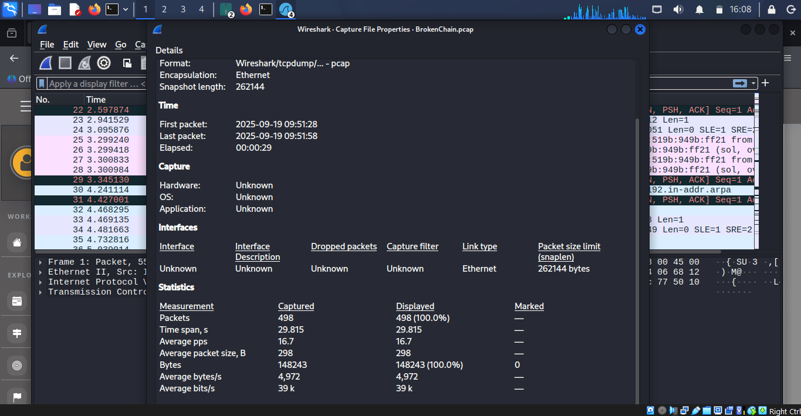
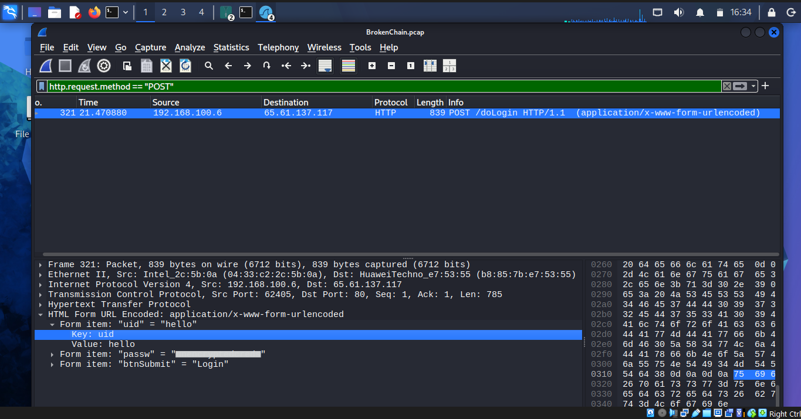
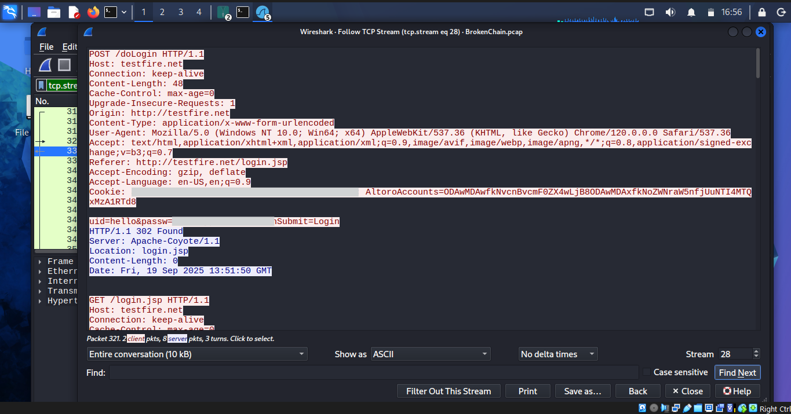
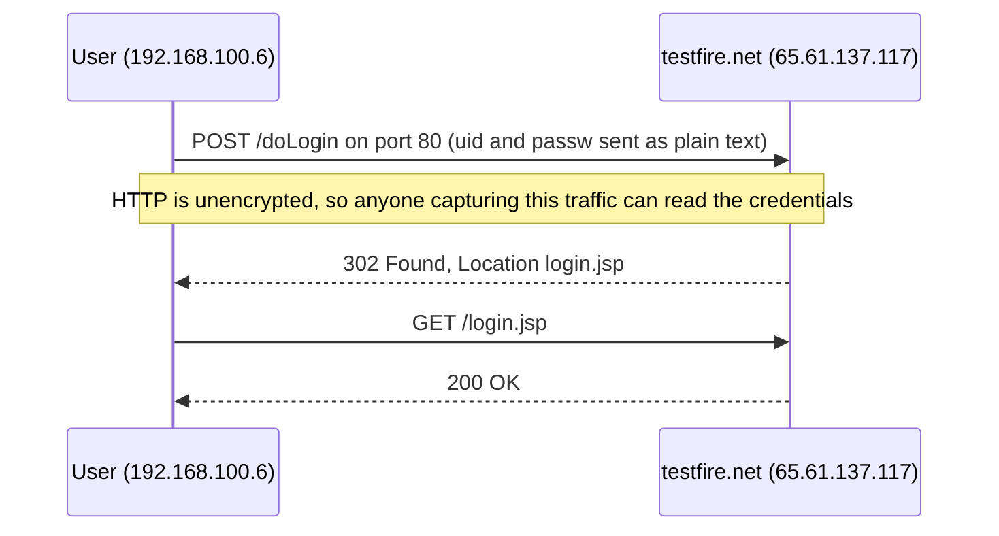
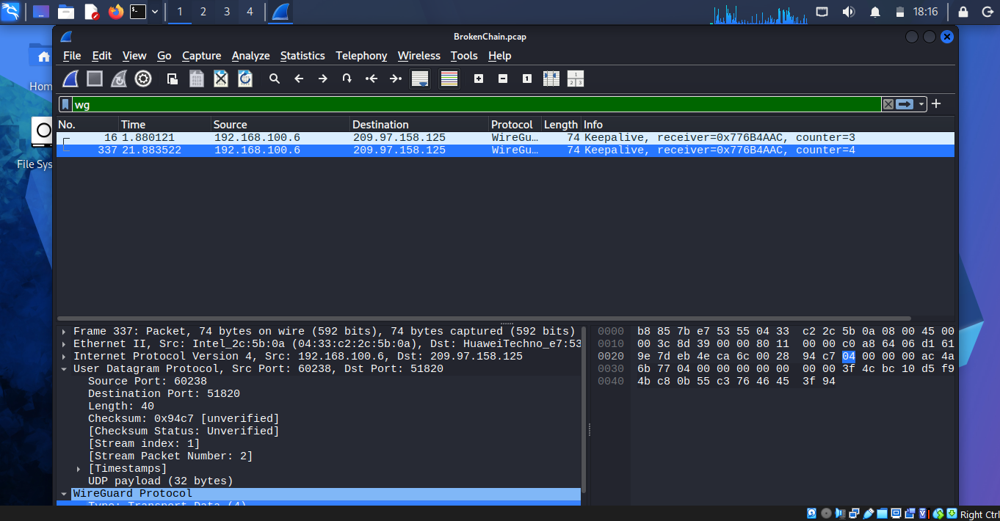

# Broken Chain: Unencrypted Traffic

## Scenario
A user logged in to a website over plain HTTP, so their credentials crossed the network readable. I was given a packet capture and had to find the server, the login page, the credentials and the secure protocols the user's machine was also running.

## Environment
- Tool: Wireshark on Kali Linux (VirtualBox)
- Evidence: `BrokenChain.pcap`, 498 packets over about 30 seconds
- SHA256: c8d7910d8c84e891aa5f20c209192670679eb856901f7bb1b92364eacd421c81

## What I did
1. Downloaded the capture, extracted it with `unzip`, and opened it in Wireshark.
2. Checked the packet count and file hash under Statistics, then Capture File Properties.
3. Filtered for the login with `http.request.method == "POST"`, which returned one packet.
4. Read the submitted form fields in the packet details, then used Follow TCP Stream to see the full request and response.
5. Filtered `udp`, then removed the known noise with `udp && !(dns || mdns || llmnr || ssdp)` to find the secure UDP protocol.
6. Filtered `wg` to read the WireGuard port, and `tls` to find the secure TCP protocol.

## What I found
### 1. The capture

498 packets over about 30 seconds. I recorded the SHA256 hash so anyone can check they have the same file.

### 2. The login

A user at 192.168.100.6 sent `POST /doLogin` to 65.61.137.117 (testfire.net) over HTTP on port 80. The form fields were `uid` and `passw`, and both were readable in the packet.

### 3. The full conversation

The Referer header showed the form was submitted from `http://testfire.net/login.jsp`. The server answered `302 Found` with `Location: login.jsp`, sending the browser back to the login page. That suggests the login was not accepted. The page body wasn't in the capture, so I can't prove it. Either way, the username and password were exposed. testfire.net is a public demo banking site made for security testing, so these were practice credentials.

### 4. Secure protocols on the same machine

Wireshark showed WireGuard (a VPN) over UDP. The client's first packet went to destination port 51820, which is the port the server listens on. TLS (TLSv1.2) was also in use over TCP.

## Problems and how I fixed them

## What I learned
