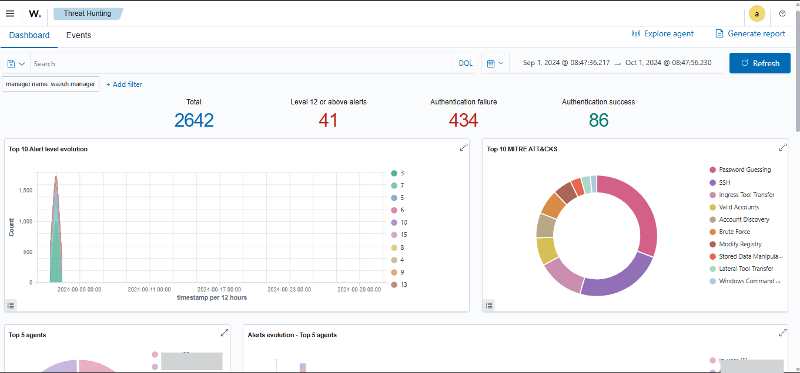
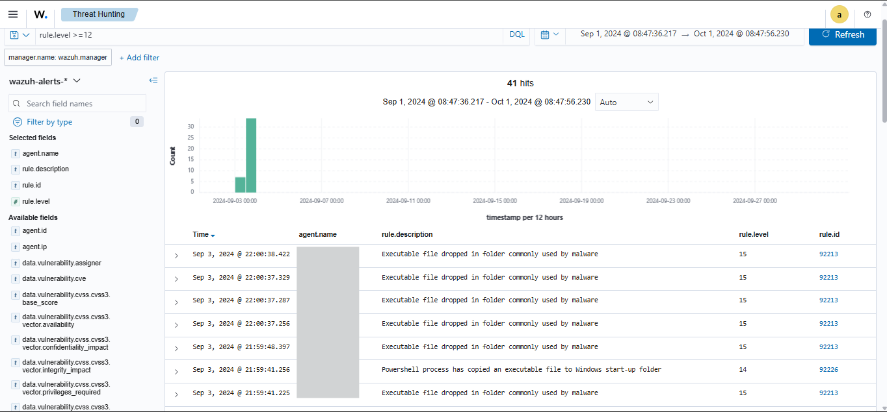
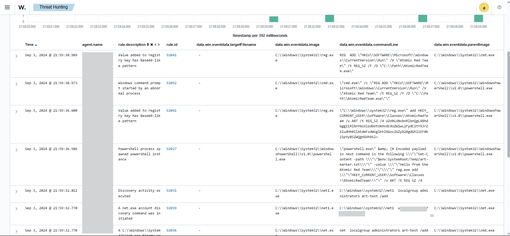
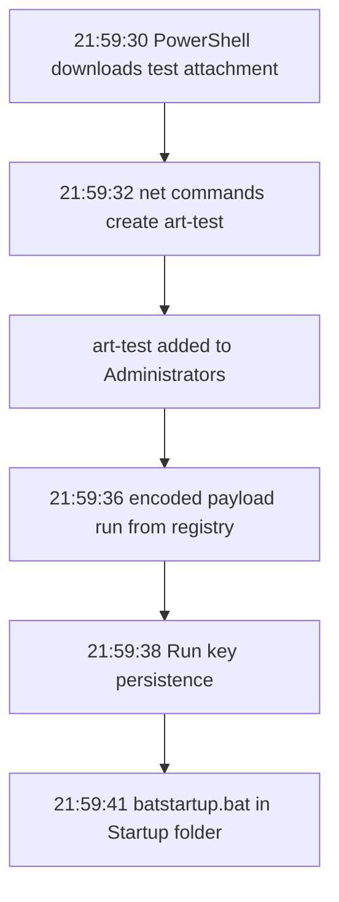
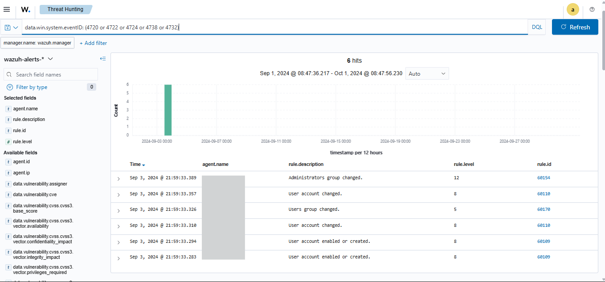
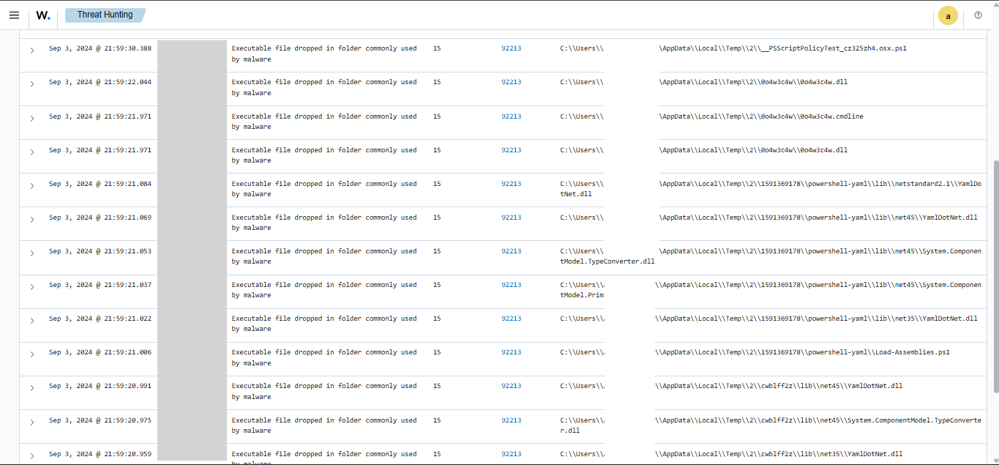
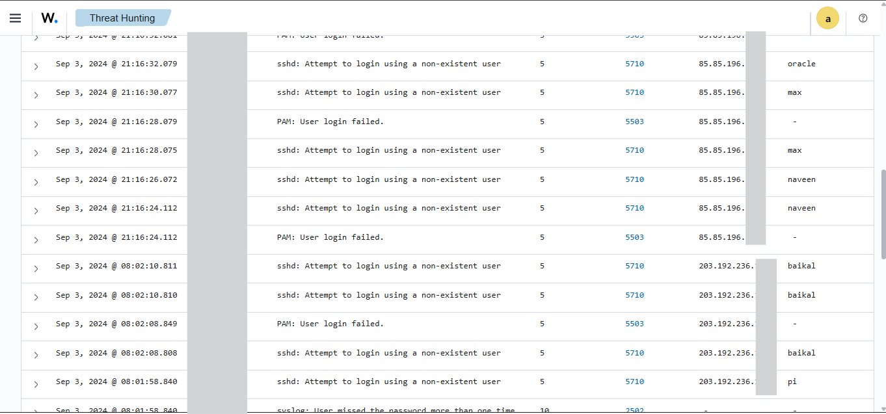
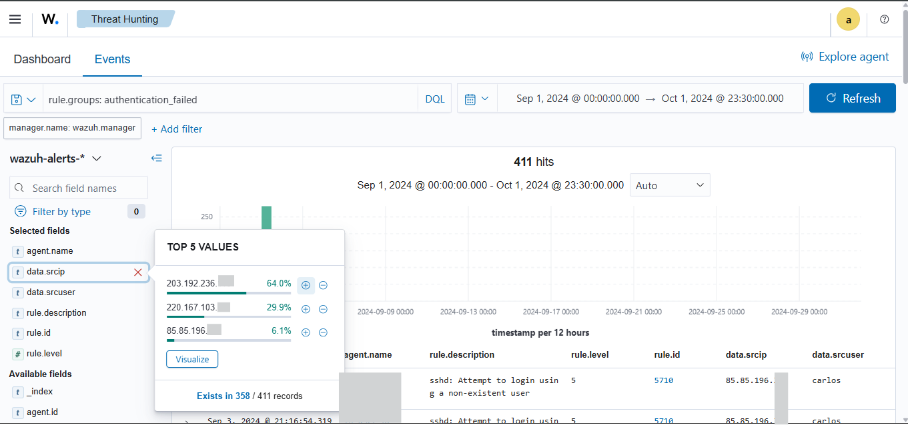
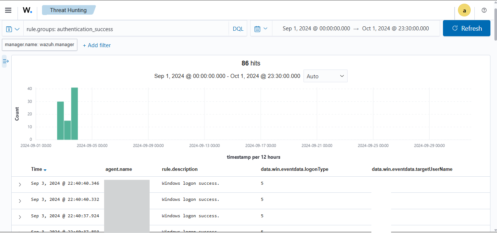
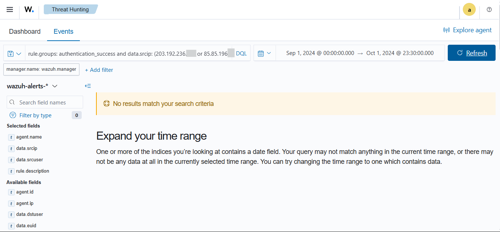

# Wazuh Investigation: September 2024 Alerts

## Scenario
I was given access to a practice Wazuh instance and no questions, so I chose my own. I looked at the alerts from September 2024, starting with the highest-severity ones, to find out which were real findings and which were noise.

## Environment
- Tool: Wazuh dashboard (Threat Hunting, Events)
- Date range: Sep 1 to Oct 1, 2024
- Two agents: a Windows host (`WIN-HOST`) and a Linux host (`linux-host`)
- The last part of each IP address is masked.
- Times are as the dashboard shows them, which is one hour ahead of the UTC time inside the events.

## What I did
1. Filtered the Events view to September 2024 and found 2,642 alerts.

2. Filtered to level 12 and above with `rule.level >= 12`, which left 41 alerts.

3. Grouped those 41 by rule description: 32 "executable file dropped", 7 CVE alerts, 1 PowerShell alert and 1 "Administrators group changed".
4. Opened the Administrators alert (Event ID 4732) and searched `data.win.system.eventID: 4720` to find the account creation.
5. Added `data.win.eventdata.targetFilename` as a column and read every path from the 32 "executable dropped" alerts.
6. Searched `data.win.system.eventID:1` (Sysmon process creation) and added the columns `image`, `commandLine` and `parentImage` to see the commands behind the changes.
7. Searched `rule.groups: authentication_failed` and looked at the source addresses and usernames.
8. Searched `rule.groups: authentication_success` and checked the logon types.

## What I found

### 1. Five simulated attacker actions in about 11 seconds
The Sysmon process events showed what ran on the Windows host:

| Time | What it did |
|---|---|
| 21:59:30 | PowerShell downloaded a phishing-attachment test file from the Atomic Red Team GitHub repository into Temp |
| 21:59:32 | `net user` created the account `art-test`, set its password, and `net localgroup` added it to Administrators |
| 21:59:36 | PowerShell stored an encoded payload in a registry key and ran it, which writes a marker file |
| 21:59:38 | `reg add` created a Run key value so a program starts at logon |
| 21:59:41 | PowerShell copied `batstartup.bat` into the all-users Startup folder |

The first is an attachment download (ATT&CK T1566.001), the second creates a local account (T1136.001), and the Run key and Startup folder are persistence (T1547.001).

### 2. The account chain
Three `net` commands ran within about 90 ms: create the account, set a password, add it to Administrators. Wazuh's account alerts (Event IDs 4720 and 4732) show the result about half a second later. The password was typed on the command line, so the log holds it in plain text. It is `<redacted>` here.

### 3. Evidence it was a test
The account name `art-test`, the registry names containing "Atomic Red Team", the marker file text, and the GitHub address `redcanaryco/atomic-red-team` all point to Atomic Red Team, a free toolkit for testing detections. So this was a simulated attack and not a real compromise.

### 4. The 32 high-severity "executable dropped" alerts were mostly noise
I read every file path. They split into three groups:

| Group | Count | What it is |
|---|---|---|
| `__PSScriptPolicyTest_...ps1` | 11 | Files PowerShell creates itself to test script policy |
| `.dll` and `.cmdline` pairs in random Temp folders | 9 | Three sets of three files |
| `powershell-yaml` module files | 12 | A PowerShell module being loaded, twice |

All were written by the normal `powershell.exe` under the Administrator account. They were level 15 because of the folder they landed in, and not because of what the files were.

### 5. The 7 CVE alerts are a separate story
They came from the Linux host, at 08:15, and say the `linux-aws` kernel package has known vulnerabilities. That's a patching note and isn't connected to the Windows activity.

### 6. SSH password guessing on the Linux host
Searching `rule.groups: authentication_failed` returned 411 alerts (the dashboard card showed 434, which probably counts a broader set of rules). Most were SSH attempts against accounts that don't exist, so they couldn't succeed. Three sources stood out, and none behaved like a person:

| Source | When | How long | Style |
|---|---|---|---|
| `203.192.236.x` | Sep 3, about 07:48 to 08:02 | about 14 minutes | Slow and steady, common names like `pi`, `test`, `admin` |
| `85.85.196.x` | Sep 3, about 21:16 | about 30 seconds | A new attempt every couple of seconds, names like `oracle`, `sa`, `dockeradmin` |
| `220.167.103.x` | Sep 2, 21:40 | under half a second | A burst of a dozen names at once, like `minecraft`, `vyos`, `deploy` |

Rule 5758 ("maximum authentication attempts exceeded") shows SSH cutting the connection off after too many tries. This matches password guessing (ATT&CK T1110). I haven't looked up who owns the addresses, so I can't say who is behind it.

### 7. Successful logins
`rule.groups: authentication_success` returned 86 alerts. 73 were Windows logons on the Windows host, and 13 were on the Linux host: 3 SSH successes (from `10.0.1.13`, `52.5.37.x` and `34.226.207.x`) and 10 PAM session-opened entries for a practice account.

The Windows logons were all logon type 5 (service logons), under accounts like `SYSTEM`, `DWM-2` and `UMFD-2`. Those are accounts Windows uses for its own services and display sessions, so they were the machine running, not people signing in. About 12 came at roughly the same minute each hour, which fits something automatic.

I searched for successful logins from the three guessing addresses and got no results.

I confirmed the search worked by running `rule.groups: authentication_success` on its own, which returned the 86 successes. So none of the three sources appear in a successful login in this period. That doesn't rule out other addresses, and I only checked these three. I also found no sign that the `220.167.103.x` burst used the practice account's name, so I found no link between that burst and the SSH successes a second later.

434 failures against 86 successes isn't a like-for-like comparison, because the failures I saw were on the Linux host and most of the successes were on the Windows host.

## Problems and how I fixed them

### 1. I first read the 32 drops as malware
- **Problem:** A burst of level 15 "executable dropped" alerts looked serious.
- **Fix:** I added the file path as a column and read every one. They were PowerShell housekeeping files.
- **Lesson:** Severity says which alert to read first, and the details say whether it matters.

### 2. My first searches didn't show what caused the account
- **Problem:** Scanning the list by eye and searching the word `art-test` returned only the account alerts, with no commands.
- **Fix:** I searched for Sysmon process creation (`data.win.system.eventID:1`) and added the command line columns. That showed the full commands.
- **Lesson:** One search coming back thin doesn't mean the data isn't there. Try a different angle.

### 3. Rule names can mislead
- **Problem:** Wazuh labelled `net user art-test /add` as "account discovery", but the command creates an account.
- **Fix:** I read the command line instead of trusting the rule description.
- **Lesson:** A rule description is a label, and the command is the evidence.

### 4. An empty search might be a typo
- **Problem:** The success search returned no results.
- **Fix:** I ran the broader search on its own first, which returned 86 hits, to confirm the query worked before relying on the empty result.
- **Lesson:** Check that a search works before trusting a "nothing found".

## What I learned
(...)
