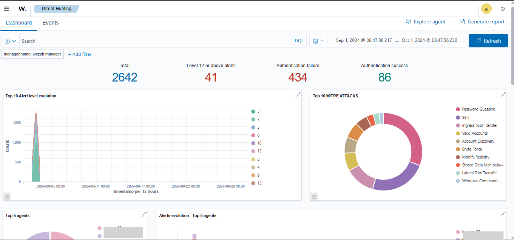
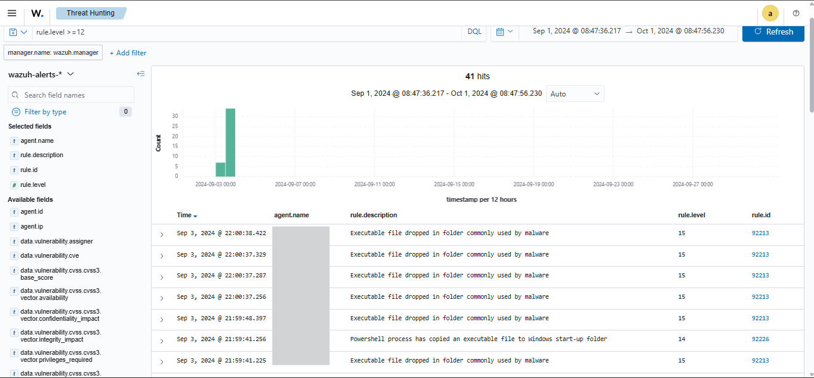
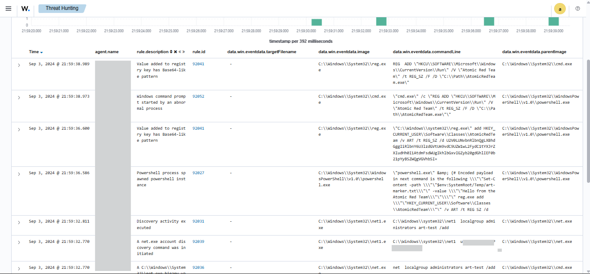
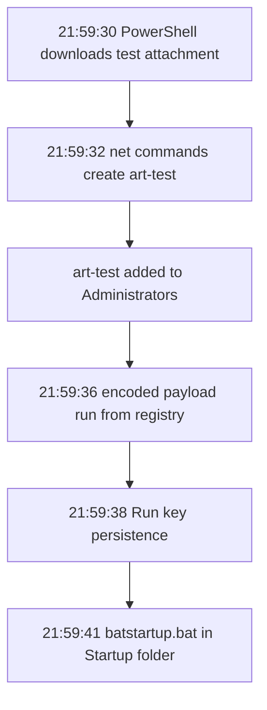

# Wazuh Investigation: September 2024 Alerts

## Scenario
I was given access to a practice Wazuh instance and no questions, so I chose my own. I looked at the alerts from September 2024, starting with the highest-severity ones, to find out which were real findings and which were noise.

## Environment
- Tool: Wazuh dashboard (Threat Hunting, Events)
- Date range: Sep 1 to Oct 1, 2024
- Two agents: a Windows host (`WIN-HOST`) and a Linux host (`linux-host`)
- The last part of each IP address is masked.
- Times are as the dashboard shows them, which is one hour ahead of the UTC time inside the events.

## What I did
1. Filtered the Events view to September 2024 and found 2,642 alerts.

2. Filtered to level 12 and above with `rule.level >= 12`, which left 41 alerts.

3. Grouped those 41 by rule description: 32 "executable file dropped", 7 CVE alerts, 1 PowerShell alert and 1 "Administrators group changed".
4. Opened the Administrators alert (Event ID 4732) and searched `data.win.system.eventID: 4720` to find the account creation.
5. Added `data.win.eventdata.targetFilename` as a column and read every path from the 32 "executable dropped" alerts.
6. Searched `data.win.system.eventID:1` (Sysmon process creation) and added the columns `image`, `commandLine` and `parentImage` to see the commands behind the changes.
7. Searched `rule.groups: authentication_failed` and looked at the source addresses and usernames.
8. Searched `rule.groups: authentication_success` and checked the logon types.

## What I found

### 1. Five simulated attacker actions in about 11 seconds
The Sysmon process events showed what ran on the Windows host:

| Time | What it did |
|---|---|
| 21:59:30 | PowerShell downloaded a phishing-attachment test file from the Atomic Red Team GitHub repository into Temp |
| 21:59:32 | `net user` created the account `art-test`, set its password, and `net localgroup` added it to Administrators |
| 21:59:36 | PowerShell stored an encoded payload in a registry key and ran it, which writes a marker file |
| 21:59:38 | `reg add` created a Run key value so a program starts at logon |
| 21:59:41 | PowerShell copied `batstartup.bat` into the all-users Startup folder |

The first is an attachment download (ATT&CK T1566.001), the second creates a local account (T1136.001), and the Run key and Startup folder are persistence (T1547.001).

### 2. The account chain
..

## What I learned
(...)
