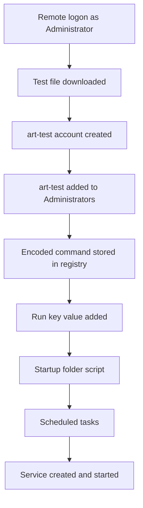

# Windows Quest: Reconstructing an Attack Timeline

## Scenario
A Windows host showed a remote logon followed by a run of suspicious commands. Using Wazuh, I rebuilt what the attacker did, in order, and measured how long it took from the first remote logon to the last persistence step. This uses the same host and data as my [September 2024 Wazuh investigation](../03-wazuh-sept-2024-investigation), looked at from the incident-timeline side.

## Environment
- Tool: Wazuh dashboard (Threat Hunting, Events)
- Host: Windows (`WIN-HOST`). The attacker's public address is masked as `197.237.16.x`.
- Times are in UTC. The dashboard shows them one hour ahead.

## What I did
1. Searched for remote logons with `data.win.system.eventID:4624 and data.win.eventdata.logonType:10`.
2. Searched Sysmon process creation (`data.win.system.eventID:1`) with the `commandLine` and `parentImage` columns to read the commands.
3. Searched for `schtasks`, `sc.exe create` and the registry Run key to find the persistence steps.
4. Decoded a Base64 command from a registry value with `base64 -d`.
5. Used the event's own timestamps to work out the elapsed time.

## What I found

### Timeline
| Time (UTC) | What happened |
|---|---|
| 20:40:08 | First successful remote logon as `Administrator`, from `197.237.16.x`. Wazuh flagged it as NTLM and a possible pass-the-hash. The alert alone doesn't prove that. |
| 20:59:30 | PowerShell downloaded a test attachment from the Atomic Red Team repository |
| 20:59:32 | New local account `art-test` created, then added to the Administrators group |
| 20:59:36 | PowerShell stored a Base64 command in the registry and ran it |
| 20:59:38 | A Run key value (`Atomic Red Team`) was added, so a program starts at logon |
| 20:59:40 | `batstartup.bat` copied into the Startup folders |
| 20:59:43 | Two scheduled tasks created. Only one ran at startup as SYSTEM |
| 20:59:45 | A Windows service (`AtomicTestService_CMD`) was created and started |

About 19 minutes 38 seconds (1,178 seconds) passed between the first remote logon and the service command.

### Persistence, in layers
The attacker set up persistence five different ways within about 15 seconds:

| Method | What it was |
|---|---|
| New admin account | `art-test`, in the local Administrators group |
| Registry Run key | A value named `Atomic Red Team`, running at the user's logon |
| Startup folders | `batstartup.bat` in the user and all-users folders |
| Scheduled tasks | One at logon, and one at system startup as SYSTEM |
| Windows service | `AtomicTestService_CMD`, created and started |

The startup task and the service are the strongest, because they run without anyone logging in.

### A hidden command
The Base64 string stored in the registry decodes to a PowerShell command that writes a short marker text file into the Windows `Temp` folder. It's harmless on its own, but encoding it hides it from simple keyword searches.

### Evidence it was a test
The `art-test` account, the "Atomic Red Team" names, the `T1053_005` task names and the `AtomicRedTeam` file paths all point to Atomic Red Team, a free toolkit for testing detections. The logs show what ran and when, but not who ran it or why.

## Problems and how I fixed them

### 1. My elapsed time was wrong twice
- **Problem:** I measured from the RDP logon alert, and my answers were rejected.
- **Fix:** One remote session left several alerts. Two "successful remote logon" alerts came earlier than the one I used. Measuring from the earliest gave the right number.
- **Lesson:** One event can leave several records, so find the earliest.

### 2. A hint that didn't match the data
- **Problem:** The task hinted at a value with three letters, but the Run key value was `Atomic Red Team`.
- **Fix:** I read the registry command itself, `REG ADD ... /V "Atomic Red Team"`, and went with the evidence.
- **Lesson:** Trust the log over the hint, and write down the mismatch.
  
## What I learned
